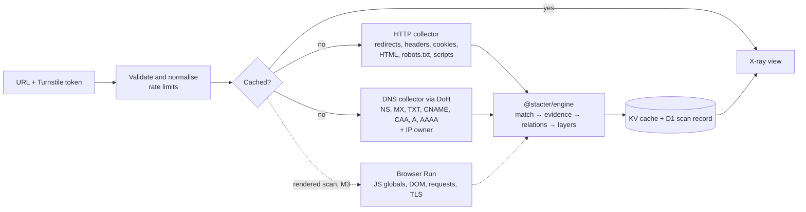

# Stacter — Development Plan & Progress

> Living document. When something meaningful changes: tick the task, update the status table, and add a dated line to the [progress log](#12-progress-log).

**Last updated:** 2026-11-03 · **Current focus:** M0 — Foundations; everything that doesn't need a Cloudflare account is done · **Next action:** create `main` and add the Cloudflare secrets (see M0), then spikes S3 and S5. M1 can start in parallel.

**Contents:** [1. Status](#1-status-at-a-glance) · [2. What we're building](#2-what-were-building) · [3. Principles](#3-principles) · [4. Layer model](#4-the-layer-model) · [5. Evidence model](#5-evidence-model) · [6. Architecture](#6-architecture) · [7. Decisions](#7-decision-log) · [8. Milestones](#8-milestones) · [9. Spikes](#9-spikes) · [10. Risks](#10-risks) · [11. Open questions](#11-open-questions) · [12. Progress log](#12-progress-log)

---

## 1. Status at a glance

Legend: ⬜ not started · 🟨 in progress · ✅ done · ⏸️ deferred

| | Milestone | What ships | Status |
|---|---|---|---|
| M0 | Foundations | Monorepo, CI, hello-world on Cloudflare Workers, spikes S1–S5 | 🟨 |
| M1 | Evidence engine | `@stacter/engine`, `@stacter/collect`, `@stacter/cli`: detections with evidence, grouped by layer | ⬜ |
| M2 | **X-ray MVP** (first public release) | Static scans on the web: layered X-ray, evidence drawer, "verify it yourself", request anatomy | ⬜ |
| M3 | Rendered scans | Headless-browser scans and the static-vs-rendered lesson | ⬜ |
| M4 | Learn hub | Technology pages, guides, fingerprint playground | ⬜ |
| M5 | Health signals | Lifecycle, release cadence, adoption trends, stewardship | ⬜ |
| M6 | Beyond URLs | Repo/lockfile input, migration recommender, compare, browser extension | ⏸️ |

---

## 2. What we're building

Stacter scans a website and shows what it's built with — **laid out in the order a request travels**, with **the evidence behind every detection** — so people learn how the web works by taking real sites apart.

> **Cloudflare** · Edge & CDN · Confirmed
> Response header `cf-ray: 8f1c2a3b4d5e6f70-SIN`
> **Why:** Cloudflare adds a Ray ID to every response it proxies; the suffix is the data centre that handled the request.
> **Verify it yourself:** `curl -sI https://example.com | grep -i cf-ray`

**Why this angle.** Detection on its own is a solved problem: Wappalyzer, BuiltWith and WhatRuns exist, and most tools match against the same community rules (the open continuation of Wappalyzer's fingerprints, [enthec/webappanalyzer](https://github.com/enthec/webappanalyzer)). What's missing is a tool that *explains*. Stacter competes on explanation, not coverage.

**Not building (for now):** technographic lead lists, bulk crawling, monitoring/alerts, accounts, bot-protection evasion.

**Context as of 2026-11** (from the initial research):
- The Deno team [joined Cloudflare](https://deno.com/blog/cloudflare) in Oct 2026: one more year of bug-fix/security releases, then Deno-led runtime development ends; Deno Deploy shuts down after six months. This is the motivating case for the health signals in M5.
- NuxtHub [went multi-cloud](https://hub.nuxt.com/changelog/self-hosting-first) and [deprecated its deploy command](https://hub.nuxt.com/docs/getting-started/migration), so Nuxt deploys to Cloudflare via Nitro's preset + Wrangler.
- Cloudflare [steers new projects to Workers rather than Pages](https://developers.cloudflare.com/workers/static-assets/migration-guides/migrate-from-pages/). Browser Rendering is now Browser Run ([10 browser-hours/month on Workers Paid, then $0.09/hour](https://developers.cloudflare.com/browser-run/pricing/)).
- On Workers, Bun is tooling only: production code runs on workerd.

---

## 3. Principles

1. **Evidence or it didn't happen.** Every detection shows the exact signal, where it was found, and the rule that matched.
2. **Explain, then show how to check.** Each signal comes with a plain-language "why this gives it away" and a "verify it yourself" step using curl, dig or DevTools.
3. **Follow the request.** Results read in request order: DNS → edge → hosting → server → framework → frontend → third-party services.
4. **Unknown is an answer.** An empty layer explains *why* it's empty (origin hidden behind a CDN, headers stripped, needs a rendered scan) instead of looking broken.
5. **Observed ≠ inferred.** "Saw `window.__NUXT__`" is different from "Nuxt implies Vue". The UI always shows which is which.
6. **Signals, not verdicts.** Health data (M5) is shown as facts with sources. Stacter never labels a project "dying".
7. **Portable core.** The engine is plain TypeScript with no runtime-specific APIs, so it runs in Workers, Bun/Node, browsers and tests.
8. **Scan respectfully.** One page per user request, an honest User-Agent, no bot-protection evasion, opt-outs honoured.

---

## 4. The layer model

| # | Layer (`id`) | Question it answers | Typical signals | Examples |
|---|---|---|---|---|
| 1 | Domain & DNS (`dns`) | Who answers for the name? Who handles email? Which SaaS has verified the domain? | NS, MX, TXT (SPF includes, verification tokens), CAA, CNAME | Cloudflare DNS, Route 53, Google Workspace, Microsoft 365, SendGrid |
| 2 | Edge & CDN (`edge`) | Who receives the request first, caches and protects it? | `server`, `via`, `cf-ray`, `x-served-by`, `x-amz-cf-id`, cookies such as `__cf_bm`, IP owner (ASN) | Cloudflare, Fastly, CloudFront, Akamai |
| 3 | Hosting & platform (`hosting`) | Where does the site actually run? | CNAME targets (`cname.vercel-dns.com`, `*.netlify.app`), platform headers (`x-vercel-id`, `x-nf-request-id`), ASN | Vercel, Netlify, GitHub Pages, AWS, Shopify |
| 4 | Server & runtime (`server`) | What software answers the request? | `server`, `x-powered-by`, session cookies (`PHPSESSID`, `JSESSIONID`) | Nginx, Apache, PHP, Node.js/Express, ASP.NET |
| 5 | Framework & CMS (`framework`) | What builds the pages? | `<meta name="generator">`, `window.__NUXT__`, `__NEXT_DATA__`, `/_nuxt/`, `/_next/`, `/wp-content/` | Nuxt, Next.js, Astro, WordPress |
| 6 | Frontend & UI (`frontend`) | What runs in the browser? | Script URLs, JS globals (`jQuery.fn.jquery`), DOM/CSS signatures | React, Vue, jQuery, Tailwind CSS, Google Fonts |
| 7 | Third-party services (`services`) | Who else does the page call? | Third-party script hosts, pixels, tag IDs (`G-…`, `GTM-…`) | Google Analytics, Tag Manager, Meta Pixel, Stripe, Sentry |

Next to the layers, a **Request anatomy** panel shows the redirect chain, the status, and every response header with an annotation (caching, compression, HTTP/3 via `alt-svc`, security headers such as HSTS and CSP).

Design notes:
- **One vendor, many layers.** Cloudflare can appear as DNS (NS records), edge (`cf-ray`) and hosting (Workers). The UI can also group by vendor and call out concentration ("this site relies on Cloudflare for 3 layers").
- **Category → layer mapping.** Fingerprints carry categories (CDN, PaaS, Web servers, JavaScript frameworks, Analytics, …). `packages/engine/src/layers.ts` maps category names to layers, with per-technology overrides. Unmapped categories land in an `other` bucket, and a test lists them whenever the fingerprints are updated. S1 found that 12% of technologies have several categories, and that the upstream category `priority` is a display weight rather than a layer, so placement follows its own precedence and, for vendors that span layers, the evidence source (D-017).
- **Stacter's own rules.** The vendored data is thin on DNS, email, CNAME-target and ASN signals (S1: 186 DNS patterns across 7,695 technologies) and has some gaps and stale rules elsewhere. Stacter adds its own rules **in the same format** under `packages/fingerprints/stacter/` and contributes upstream where they fit.

---

## 5. Evidence model

### Contracts (draft)

```ts
type Layer = 'dns' | 'edge' | 'hosting' | 'server' | 'framework' | 'frontend' | 'services' | 'other'

type SignalSource =
  | 'header' | 'cookie' | 'meta' | 'html' | 'text' | 'url' | 'robots'
  | 'scriptSrc' | 'inlineScript' | 'scriptContent' | 'css'
  | 'dns' | 'asn' | 'tls'
  | 'jsGlobal' | 'dom' | 'request' // rendered scans only
  | 'implied'                      // derived from another detection

interface DnsRecord {
  type: 'A' | 'AAAA' | 'CNAME' | 'NS' | 'MX' | 'TXT' | 'CAA'
  name: string
  data: string
  ttl?: number
}

interface Evidence {
  source: SignalSource
  key?: string                                  // header/cookie/meta name, JS property chain, DNS record type…
  matched: string                               // exact matched text (truncated)
  context?: { before: string; after: string }   // surrounding text, for highlighting
  location?: { resource: string; line?: number; column?: number }
  rule: { id: string; pattern: string }         // stable rule id + the pattern as authored
  version?: string
  confidence: number                            // this evidence's contribution, 0–100
  phase: 'static' | 'rendered'
}

interface Detection {
  tech: { slug: string; name: string; vendor?: string; website?: string; categories: string[]; cpe?: string }
  layer: Layer
  version?: string
  confidence: number                            // sum of evidence, capped at 100
  certainty: 'confirmed' | 'likely' | 'possible' | 'inferred'
  evidence: Evidence[]
  impliedBy?: string[]                          // tech slugs
}

interface ScanResult {
  id: string
  input: string
  finalUrl: string
  redirects: { url: string; status: number }[]
  status: 'ok' | 'blocked' | 'error' | 'timeout'
  blockedBy?: string                            // e.g. "Cloudflare challenge"
  mode: 'static' | 'rendered'
  layers: Record<Layer, Detection[]>
  anatomy: { headers: [name: string, value: string][]; dns: DnsRecord[] }
  versions: { engine: string; fingerprints: string } // fingerprints = vendored commit
  scannedAt: string
}
```

**Rule IDs** are `tech/field/key` for keyed fields (headers, cookies, meta, js, dns) and `tech/field/<short hash of pattern>` otherwise. Explanations attach by `field + key` or by a pattern substring, so they survive upstream reshuffles.

**Certainty:** `confirmed` = 100, `likely` = 50–99, `possible` < 50, `inferred` = only reached through `implies`.

### Worked example (illustrative output)

```text
EDGE & CDN
  Cloudflare ............................................ Confirmed
    header   cf-ray: 8f1c2a3b4d5e6f70-SIN
    header   server: cloudflare
    why      Cloudflare adds a Ray ID to every response it proxies; "SIN" is
             the data centre that handled our request.
    verify   curl -sI https://example.com | grep -iE '^(cf-ray|server):'

SERVER & RUNTIME
  — Not visible: the origin sits behind Cloudflare, which replaces the origin's
    `server` header. A rendered scan usually won't reveal it either.

FRAMEWORK & CMS
  Nuxt .................................................. Confirmed
    inline   <script>window.__NUXT__={};window.__NUXT__.config=…   (line 12)
    script   /_nuxt/entry.3f2a1b9c.js
    why      Nuxt embeds data in the page so the browser can hydrate it, and
             serves build assets from /_nuxt/ unless app.buildAssetsDir changes it.
    verify   View source → search "__NUXT__"; DevTools → Network → filter "_nuxt"

FRONTEND & UI
  Vue.js ................................................ Inferred (implied by Nuxt)
```

### Explanation content

Explanations live in `content/` as data, so the web app and the CLI share them:

```yaml
# content/tech/nuxt.yml (illustrative)
slug: nuxt
layer: framework
summary: A Vue framework that renders pages on the server and hydrates them in the browser.
signals:
  - match: { field: js, key: __NUXT__ }
    why: Nuxt embeds state and runtime config in the page for hydration.
    verify: View source and search for "__NUXT__".
  - match: { field: scriptSrc, contains: /_nuxt/ }
    why: Nuxt serves its build assets from /_nuxt/ by default.
    hide: Changing app.buildAssetsDir removes this signal.
alternatives: [next-js, sveltekit, astro]
reviewed: 2026-11-03
sources: [https://nuxt.com/docs]
```

- **Coverage:** curated explanations for the most common technologies (~50 in M2, ~100 in M4). The long tail gets an auto-generated "how we detect it", built from its rules plus the fingerprint's description.
- **Every explanation** carries a `reviewed` date and sources.
- **"Verify it yourself" templates** by signal type:

| Signal | Verify with |
|---|---|
| Response header | `curl -sI <url>` · DevTools → Network → document → Headers |
| Cookie | DevTools → Application → Cookies · `Set-Cookie` lines in `curl -sI <url>` |
| Meta tag / HTML / inline script | View source (Ctrl/⌘+U) → search |
| Script URL | DevTools → Network → JS |
| JS global (rendered) | DevTools console, e.g. `window.__NUXT__`, `jQuery.fn.jquery` |
| DNS record | `dig +short NS example.com` (likewise MX, TXT, CNAME, CAA) |
| IP owner (ASN) | `dig +short TXT <reversed-ip>.origin.asn.cymru.com` |
| TLS issuer | `openssl s_client -connect example.com:443 -servername example.com </dev/null 2>/dev/null \| openssl x509 -noout -issuer` |

---

## 6. Architecture

### Repo layout (target)

```text
stacter/
├── apps/
│   └── web/                 # Nuxt 4 → Cloudflare Workers (UI + /api)
│       ├── app/             # pages and components: X-ray, evidence drawer, request anatomy
│       └── server/
│           ├── api/         # thin handlers: POST /api/scan, GET /api/scans/:id
│           └── adapters/    # the only Cloudflare-specific code: KV, D1, Browser Run, rate limits
├── packages/
│   ├── engine/              # @stacter/engine: compile rules, match, evidence, relations, layers (pure TS)
│   ├── collect/             # @stacter/collect: portable collectors, HTTP (fetch) and DNS (DoH)
│   ├── fingerprints/        # vendored webappanalyzer @ pinned commit + Stacter rules + compile script
│   └── cli/                 # @stacter/cli: `stacter scan|record` for development and fixtures
├── content/                 # explanations: tech/, signals/, headers/, guides/
├── spikes/                  # throwaway spike scripts
└── docs/
    ├── PLAN.md              # this file
    └── spikes.md            # spike findings
```

### Scan pipeline



### Static scan limits (v1 defaults)

| Concern | Default |
|---|---|
| Schemes and ports | `http`, `https`; default ports only |
| Blocked targets | Private, loopback, link-local and reserved IPs; `localhost`, `*.local`, `*.internal`. Checked on input, after DNS resolution, and on every redirect hop |
| Redirects | Followed manually, ≤ 5 hops, each re-validated and recorded |
| Main document | 10 s timeout, 5 MB cap, charset from headers/meta |
| `robots.txt` | 3 s timeout, 100 KB cap |
| External scripts | ≤ 8 (first-party first), 512 KB each, 2 MB total |
| DNS | DoH JSON (`cloudflare-dns.com` or `dns.google`), 2 s per query |
| Identity | Honest User-Agent: `Stacter/<version> (+https://<domain>/about/scanner)` |
| Cache | KV, 24 h; the key includes engine and fingerprint versions |

The Worker never executes fetched JavaScript: the engine only parses it and matches it against rules. Rendered scans run page JavaScript inside Browser Run, never in our Worker.

### Engine internals

- **Compile once.** Rules are parsed and validated at build time (`packages/fingerprints` → compiled JSON); RegExps are built lazily, once per isolate.
- **Parsing:** `htmlparser2` for extraction with source offsets, `css-select` for `dom` rules. Not Workers' `HTMLRewriter`, which only exists on Workers.
- **Fingerprint fields covered by static scans:** `headers`, `cookies`, `meta`, `html`, `text`, `url`, `robots`, `scriptSrc`, `scripts`, `dns`, `dom` (existence, attributes and text), and `js` through an inline-assignment heuristic: explicit global assignments only (e.g. `window.__NUXT__=` inside an inline script), scored lower than a runtime hit. S2 showed that plain substring matching of `js` keys is both slow and wrong.
- **Rendered scans only:** `js` (real runtime values), `dom` properties, `xhr`. **Skipped:** `probe`, since it costs extra requests per technology.
- **Performance budget:** < 50 ms CPU p95 for typical pages. S2 measured the design that gets there (D-018): extract each regex's required literal at build time, find all literals in one Aho–Corasick pass per input, and run only the candidate regexes. That took 12–67 ms per page (163 KB–1.3 MB), against 52–809 ms for running every regex. The automaton and literal table are precomputed at build time, and RegExps are compiled lazily.
- **Safety:** the rules come from a third party, so lint regexes for catastrophic backtracking at compile time and cap inputs.
- **Gotcha:** inside Workers, `Date.now()` and `performance.now()` don't advance during synchronous work. Benchmark the engine in Bun/Node (via the CLI) and confirm with Workers' CPU-time metrics.

### Storage and privacy

- **KV:** scan cache.
- **D1:** `scans` (permalinks: result JSON + versions) and `scan_detections` (tech, layer, confidence) for aggregate stats; later `tech_health`.
- **Privacy:** scan pages are unlisted and `noindex` by default; requester IPs are kept only for rate-limit windows; site owners can opt out.

### Testing

- **Unit tests:** pattern parser, each matcher, version extraction, confidence, relations, layer mapping.
- **Golden fixtures:** a minimal snapshot per seed technology, hand-written or trimmed to the relevant snippets. Don't commit full copies of third-party pages.
- **Runtime parity:** engine tests run under Node *and* inside workerd (`@cloudflare/vitest-plugin`), set up in M0.
- **Accuracy set:** ~30 sites with publicly known stacks (including Stacter itself). Track the precision of Confirmed detections per layer.
- **E2E:** Playwright against `wrangler dev`: scan → X-ray → evidence drawer.
- **Untrusted content:** evidence snippets are third-party text. Render them as text, never with `v-html`.

---

## 7. Decision log

| ID | Date | Decision | Status |
|---|---|---|---|
| D-001 | 2026-11-03 | Education-first, evidence-first product: compete on explanation, not detection coverage | Decided |
| D-002 | 2026-11-03 | Seven layers in request order (§4) plus a Request anatomy panel | Proposed — confirm in M2 |
| D-003 | 2026-11-03 | Nuxt 4.x on Cloudflare **Workers + Static Assets** via Nitro's `cloudflare_module` preset and Wrangler. Not Pages (Cloudflare steers new projects to Workers); not NuxtHub (went multi-cloud, deprecated its deploy command) | Decided |
| D-004 | 2026-11-03 | Bun for installs, workspaces and scripts only. Production runs on workerd, so no `Bun.*` / `bun:*` APIs in shipped code | Decided |
| D-005 | 2026-11-03 | The detection engine is a pure, runtime-agnostic TS package. Cloudflare-specific code lives only in `apps/web/server/adapters` | Decided |
| D-006 | 2026-11-03 | Fingerprints: vendor `enthec/webappanalyzer` at a pinned commit; add Stacter rules in the same format | Decided (S1 confirmed the license and format) |
| D-007 | 2026-11-03 | `htmlparser2` + `css-select` for parsing (portable), not `HTMLRewriter` | Proposed |
| D-008 | 2026-11-03 | Vitest across the repo, run through Bun. Engine tests run under Node and inside workerd via `@cloudflare/vitest-plugin` (the renamed `vitest-pool-workers`) | Decided (M0) |
| D-009 | 2026-11-03 | DNS via DoH JSON APIs. IP owner via Team Cymru over DoH (two DNS queries through the same client), with RIPEstat as the fallback | Decided (S4) |
| D-010 | 2026-11-03 | Project license: **GPL-3.0-only**, matching the fingerprint data (GPL v3, no "or any later version" notice). It covers the whole repo, including the engine when it ships to browsers later | Decided |
| D-011 | 2026-11-03 | Scan permalinks are unlisted and `noindex`; no public "recent scans" feed in v1 | Proposed |
| D-012 | 2026-11-03 | Never evade bot protection (no residential proxies, no CAPTCHA solving): report "blocked" and explain it | Decided |
| D-013 | 2026-11-03 | Workers Paid from M2: the free plan's 10 ms CPU limit won't fit rule matching | Decided |
| D-014 | 2026-11-03 | Deploy from GitHub Actions on pushes to `main`, and only once the `CLOUDFLARE_API_TOKEN` and `CLOUDFLARE_ACCOUNT_ID` secrets exist (rather than Workers Builds): one pipeline, and deploys only happen after the checks pass | Decided |
| D-015 | 2026-11-03 | TypeScript 6.0: typescript-eslint doesn't support TypeScript 7 yet (`<6.1.0`). Revisit when it does | Decided |
| D-016 | 2026-11-03 | Workers runtime types are generated by `wrangler types` on install, not committed | Decided |
| D-017 | 2026-11-03 | Layer placement: category → layer defaults; for multi-category technologies, prefer framework > server > hosting > edge > frontend > services; place evidence by its source when that points to another layer (NS records → DNS); per-technology overrides | Proposed (S1); confirm in M1 |
| D-018 | 2026-11-03 | Matching: required-literal prefilter with one Aho–Corasick pass per input, lazy RegExp compilation, and setup precomputed at build time | Decided (S2) |

---

## 8. Milestones

### M0 — Foundations 🟨

**Goal:** a deployable skeleton, CI, and the risky unknowns answered.

- [x] Decide the license (D-010) and add `LICENSE`: GPL-3.0-only
- [x] Bun workspaces: root `package.json` with `apps/*` and `packages/*`; commit `bun.lock`
- [x] Shared strict TypeScript config (`tsconfig.base.json`)
- [x] `apps/web`: Nuxt 4 set up like Cloudflare's C3 Nuxt template (`cloudflare_module` preset); `wrangler.jsonc` with Static Assets. Verified in workerd with `wrangler dev`, and with `wrangler deploy --dry-run`
- [x] Placeholder page that renders the seven layers from `@stacter/engine`, plus `/api/health`
- [x] Choose a deploy path: GitHub Actions + `wrangler deploy` (D-014)
- [x] Lint with `@nuxt/eslint-config` (flat config, stylistic) across the repo, plus a portability guard for the engine
- [x] Vitest in `packages/engine`, with every test running under Node and inside workerd (`@cloudflare/vitest-plugin`)
- [x] CI: `bun install --frozen-lockfile`, lint, typecheck, test, build; green on the first run
- [x] Spikes S1, S2 and S4 run and recorded (§9, [docs/spikes.md](spikes.md))
- [ ] **Owner:** create `main` from this branch and make it the default branch. The repo's only branch is currently `claude/ecstatic-feynman-mk5yhj`
- [ ] **Owner:** add the `CLOUDFLARE_API_TOKEN` and `CLOUDFLARE_ACCOUNT_ID` repository secrets (README → Deploying)
- [ ] First deploy of the placeholder to `*.workers.dev`
- [ ] Spikes S3 and S5, plus the Workers half of S2 and S4 (they all need the deployed Worker)

**Exit:** `main` deploys to Workers, CI is green, and spike findings are recorded in §9.

### M1 — Evidence engine ⬜

**Goal:** `@stacter/engine` turns a signal snapshot into detections with exact, located evidence, grouped by layer, usable from the CLI.

Fingerprints
- [ ] Sync script: fetch webappanalyzer at a pinned commit into `packages/fingerprints/vendor/`, with `SOURCE.md` (commit, date, license)
- [ ] Compiler: parse pattern strings (`regex\;version:\1\;confidence:50`) into `{ regex, version, confidence }`; validate against the schema; lint regexes (flag the `[\s\S]*` + literal shape, S2); extract each regex's required literal; emit compiled JSON with stable rule IDs, the literal table and the automaton (D-018)
- [ ] Stacter rules, same format: DNS providers (NS), email providers (MX, e.g. Cloudflare Email Routing), SPF includes, domain-verification TXT records, hosting CNAME targets, ASN → provider. Plus the S1 gaps: Next.js `/_next/` and `__NEXT_DATA__`, Nuxt's `x-powered-by: Nuxt`, and current Cloudflare cookies (`__cf_bm`; upstream still has the retired `__cfduid`). Open upstream PRs where they fit

Engine
- [ ] HTML extraction (`htmlparser2`): meta tags, script URLs, inline scripts, text, inline styles, all with source offsets
- [ ] Static matchers: `headers`, `cookies`, `meta`, `html`, `text`, `url`, `robots`, `scriptSrc`, `scripts`, `dns`, `dom` (static subset), with regexes behind the single-pass literal prefilter and compiled lazily (D-018)
- [ ] Inline-assignment heuristic for `js` keys: explicit `window.X =`, `self.X =` and `globalThis.X =` assignments only, with lower confidence than a runtime hit
- [ ] Evidence capture: matched text with context, location (resource + line/column), rule ID
- [ ] Version extraction, including the ternary syntax; merge versions across evidence
- [ ] Confidence aggregation → `confirmed` / `likely` / `possible`; `inferred` for implies
- [ ] Relations: `implies` (with the reason recorded), `requires`, `requiresCategory`, `excludes`
- [ ] Layers: category → layer defaults (draft in [docs/spikes.md](spikes.md#s1--fingerprint-data)), multi-category precedence and evidence-source placement (D-017), per-tech overrides, `other` bucket, unmapped-category test
- [ ] Export `jsKeys()` and `domSelectors()` so the rendered collector (M3) knows what to evaluate

Collectors and CLI
- [ ] `@stacter/collect` HTTP collector: manual redirects, caps and timeouts from §6, `Set-Cookie` parsing, charset decoding
- [ ] `@stacter/collect` DNS collector: DoH for A/AAAA/CNAME/NS/MX/TXT/CAA, plus IP owner via Team Cymru (D-009). Normalise TXT quoting, and treat an SOA-only `Authority` as "no records" (S4)
- [ ] CLI: `stacter scan <url> [--json] [--explain]` (grouped by layer, with evidence and "why"); `stacter record <url>` (writes a trimmed fixture)

Quality
- [ ] Unit tests per matcher; ≥ 1 golden fixture per seed technology (M2 list)
- [ ] The engine test suite passes under Bun/Node and in workerd
- [ ] Benchmark against the S2 baseline (12–67 ms per page): < 50 ms CPU p95 for typical pages, now including `htmlparser2` extraction, which S2 didn't measure

**Exit:** `stacter scan` on a Nuxt-on-Cloudflare site prints Cloudflare (`cf-ray`, `server: cloudflare`) and Nuxt (`__NUXT__`, `/_nuxt/`) with located evidence, plus Vue as *inferred*. Fixtures pass in both runtimes, within the CPU budget.

### M2 — X-ray MVP (first public release) ⬜

**Goal:** anyone can scan a site, read it layer by layer, open any detection, and reproduce the evidence themselves.

Backend
- [ ] `POST /api/scan` (validate → cache → collect → analyze → persist → respond) and `GET /api/scans/:id`
- [ ] URL safety rules from §6, including re-validation on every redirect hop
- [ ] Bot-wall detection → `blocked` status with an explanation (e.g. Cloudflare's `cf-mitigated: challenge` header). Never evade (D-012)
- [ ] KV cache; D1 scan records for permalinks
- [ ] Abuse controls: Turnstile, per-IP limits (Workers Rate Limiting binding), per-target cooldown, opt-out list
- [ ] `/about/scanner` page: what Stacter fetches, its User-Agent, how to opt out
- [ ] Production deploy on a custom domain, Workers Paid (D-013)

Frontend — the education core
- [ ] Landing page: URL input plus example scans, starting with Stacter scanning itself (Nuxt on Cloudflare)
- [ ] X-ray view: seven layers in request order; tech chips with certainty badges (Confirmed / Likely / Possible / Inferred)
- [ ] Evidence drawer: signal type and key, matched text highlighted in context (the raw header list, or the HTML excerpt with line number), the rule, the plain-language "why", and "verify it yourself"
- [ ] Empty-layer explanations: "hidden behind a CDN", "headers stripped", "needs a rendered scan"
- [ ] Request anatomy panel: redirect chain, annotated response headers, DNS records table
- [ ] Vendor-concentration callout (same vendor across several layers)
- [ ] Accessibility: semantic layer list (not canvas-only), badges that don't rely on colour alone

Content
- [ ] Signal glossary: response header, cookie, meta tag, HTML, script URL, inline script, script content, robots.txt, DNS record types, IP owner (ASN), "implied"
- [ ] Header glossary for ~40 common response headers
- [ ] Curated explanations for the seed technologies:
  - **DNS:** Cloudflare DNS, Amazon Route 53, Google Cloud DNS, Google Workspace, Microsoft 365, SendGrid, Mailgun, Amazon SES
  - **Edge:** Cloudflare, Fastly, Amazon CloudFront, Akamai
  - **Hosting:** Vercel, Netlify, GitHub Pages, Cloudflare Workers/Pages, AWS, Google Cloud, Shopify, Squarespace, Wix, Webflow
  - **Server:** Nginx, Apache, LiteSpeed, Microsoft IIS, PHP, Node.js, Express, ASP.NET
  - **Framework & CMS:** WordPress, Next.js, Nuxt, Astro, SvelteKit, Gatsby, Drupal
  - **Frontend:** React, Vue.js, jQuery, Tailwind CSS, Bootstrap, Google Fonts, Font Awesome
  - **Services:** Google Analytics, Google Tag Manager, Meta Pixel, Hotjar, HubSpot, Stripe, reCAPTCHA, Cloudflare Turnstile, Sentry, Plausible

Quality
- [ ] Labeled accuracy set (~30 sites); Confirmed precision tracked per layer
- [ ] Playwright E2E: scan → X-ray → evidence drawer

**Exit:** someone new to web development can scan a site, follow the layers, and reproduce any detection with curl, dig or DevTools. Confirmed precision ≥ 95% on the labeled set. Static scan p95 < 8 s.

### M3 — Rendered scans ⬜

**Goal:** detect client-rendered apps, and teach why static and rendered views differ.

- [ ] Browser Run via `@cloudflare/puppeteer`: ~15 s hard cap per scan, session reuse, concurrency guard (Durable Object)
- [ ] Collect: rendered DOM, network requests (script URLs, XHR/fetch hosts), JS globals (batch-evaluate the engine's `jsKeys()`), `dom` rules including properties, cookies set by JS, TLS details if S5 confirms they're available
- [ ] Merge static and rendered evidence; tag evidence "seen only after JavaScript ran"
- [ ] Static-vs-rendered lesson view: what appeared after JS ran, and why (SSR vs CSR)
- [ ] Stricter limits for rendered scans (per IP per day); log browser-seconds per scan; monthly budget alarm

**Exit:** client-rendered React/Vue apps are detected with runtime evidence, and the results page explains the static-vs-rendered difference.

### M4 — Learn hub ⬜

**Goal:** turn the scanner's knowledge into pages people find and learn from.

- [ ] `/tech/:slug` for every fingerprinted technology: auto-generated "how we detect it" plus curated content where available
- [ ] Curated content for the top ~100 technologies (by HTTP Archive popularity)
- [ ] Guides: anatomy of a request · what response headers reveal · what DNS reveals (email, SaaS verifications) · how CDNs hide the origin · SSR vs CSR (and why React is hard to spot) · reducing your fingerprint (and why it's rarely worth it)
- [ ] Fingerprint playground: paste headers or HTML and see which rules match, and why (the engine runs in the browser; depends on D-010)
- [ ] Beginner / expert toggle: plain-language view vs raw rules and regexes
- [ ] SEO: SSR and a sitemap for tech and learn pages; scan pages stay `noindex`

**Exit:** learn pages are live, and every tech page links to its signals in the glossary and to an example scan.

### M5 — Health signals ⬜

**Goal:** show how healthy each detected technology is, with sources and without verdicts.

- [ ] Map technologies → endoflife.date product, GitHub repo, npm package (top 100 first)
- [ ] Scheduled ingest (Cron Trigger → D1): EOL cycles, latest release and cadence, recent contributors, archived/deprecated flags, npm download trend, HTTP Archive adoption trend
- [ ] Steward and funding model (company / foundation / community; notable events such as acquisitions), curated with sources
- [ ] Version-aware lifecycle: detected version → EOL status of its release cycle
- [ ] Transparent rubric: show every signal with its source; no "dying" labels
- [ ] Back-test the rubric against known cases: Deno (2026), Create React App (2025), Vue 2 (2023), AngularJS (2021), Moment.js (2020), `request` (2020)

**Exit:** tech pages and scan results show lifecycle signals with sources, and the back-test results are written up here.

### M6 — Beyond URLs ⏸️ (exploratory)

- [ ] Repo/lockfile/SBOM input (`package.json` + lockfiles including `bun.lock`, `deno.json`, Dockerfile, Wrangler config) → the same layer and health model
- [ ] Migration recommender for flagged technologies, evidence-backed (seed data: e18e's module-replacements)
- [ ] Compare two sites; re-scan history and stack diffs over time
- [ ] Browser extension reusing the engine

---

## 9. Spikes

| ID | Question | Approach | Status | Finding |
|---|---|---|---|---|
| S1 | Fingerprint data: license, schema fields (does `certIssuer` exist?), technology and category counts, layer coverage | Pull the pinned commit; read `LICENSE` and `schema.json`; draft the category → layer map | ✅ | GPL v3 with no "or later" notice (D-010). 7,695 technologies, 13,958 patterns, all valid JS RegExps. `certIssuer` exists but only 6 technologies use it. 88% of technologies have a rule a plain fetch can see; DNS rules are thin. Gaps: Next.js `/_next/`, Nuxt `x-powered-by`, a stale Cloudflare cookie; Deno has no rules of its own, Bun none at all. Category `priority` isn't a layer (D-017). [Details](spikes.md#s1--fingerprint-data) |
| S2 | Can the engine stay under 50 ms CPU p95? | Benchmark compile + match on real pages in Bun/Node; confirm with Workers CPU-time metrics | 🟨 | Locally, running every regex costs 52–809 ms per page; a required-literal prefilter with one Aho–Corasick pass gets 12–67 ms with identical detections (D-018). The Workers check waits for a deploy. [Details](spikes.md#s2--matching-cpu-budget) |
| S3 | How often do sites block or challenge requests from Workers? | Static-fetch ~50 popular sites from a deployed Worker; log statuses and challenge markers | ⏸️ | Needs the deployed Worker |
| S4 | DNS and IP owner from Workers | DoH for every record type; compare Team Cymru (TXT over DoH) with RIPEstat for ASN | 🟨 | DoH JSON covers every record type (format notes recorded). Team Cymru and RIPEstat agree (D-009). Latency from Workers waits for a deploy. [Details](spikes.md#s4--dns-and-ip-owner) |
| S5 | Browser Run capabilities and cost | Puppeteer session: JS globals, network log, cookies, TLS `securityDetails()`; browser-seconds per scan; session reuse | ⏸️ | Needs a Cloudflare account |
| S6 | Content pipeline | Nuxt Content on Workers (D1) vs importing `content/` as JSON at build time | ⬜ | |
| S7 | TLS issuer for static scans | Workers' `fetch` doesn't expose the peer certificate. Options: rendered scans only, Certificate Transparency logs, or skip | ⬜ | Lower priority: S1 found only 6 technologies with `certIssuer` rules |

---

## 10. Risks

| Risk | Mitigation |
|---|---|
| Wrong detections undermine an education tool | Evidence-first UI makes mistakes visible; "report a wrong detection" turns into a new fixture; accuracy set in CI |
| Bot walls block requests from Workers | Detect and explain (`blocked`); rendered scans; never evade (D-012) |
| ReDoS or CPU spikes from third-party regexes | Compile-time regex lint, input caps, CPU budget validated in S2 |
| Scanner abused as a proxy or to hammer sites | Turnstile, per-IP and per-target limits, caching, honest User-Agent, opt-out |
| XSS through evidence snippets | Render as text only; strict CSP on Stacter itself |
| Fingerprint license (GPL-3.0) | Settle D-010 before the first public release |
| Upstream fingerprint drift | Pinned commit, scheduled sync with diff review, unmapped-category test |
| Browser Run cost | Per-IP daily limits, 15 s cap, budget alarm |
| Nuxt 5 / Nitro v3 migration | Keep server routes thin; logic lives in packages |
| Explanations go stale or are wrong | `reviewed` date and sources on every explanation; periodic review |

---

## 11. Open questions

1. **Domain and branding.**
2. **Scan visibility:** keep the unlisted + `noindex` default (D-011)?
3. **UI kit:** Nuxt UI or hand-rolled Tailwind?
4. **Content authoring:** fully hand-written, or LLM-drafted with human review? Accuracy matters more than speed for an education tool.
5. **First public release:** ship at M2, or wait for M3 so client-rendered sites don't look sparse?
6. **Logos:** the fingerprint repo ships brand icons. The GPL covers the files, not the trademarks: show them (for identification only) or use neutral icons?

---

## 12. Progress log

Newest first. One line per meaningful change: merged work, spike results, decisions.

- **2026-11-03** — M0 under way. License set to GPL-3.0-only. Bun workspace with Nuxt 4 on Cloudflare Workers (`apps/web`) and `@stacter/engine` (`packages/engine`); every engine test runs under both Node and workerd; ESLint includes an engine portability guard. CI was green on its [first run](https://github.com/nickczj/stacter/actions/runs/41653430138). Spikes S1, S2 and S4 are recorded in [docs/spikes.md](spikes.md). The first deploy, S3 and S5 wait on a Cloudflare account and a `main` branch.
- **2026-11-03** — Repository started with this plan; no code yet. Direction set: education-first X-ray with evidence for every detection, results laid out in request order (DNS → edge → hosting → server → framework → frontend → services). Stack: Nuxt 4 on Cloudflare Workers, Bun for tooling.

### Updating this document

- Tick tasks as they land and link the PR or commit next to them.
- Change a milestone's status in §1 when work on it starts or finishes, and move **Current focus** at the top.
- Record decisions in §7, spike outcomes in §9, and a dated line here.
